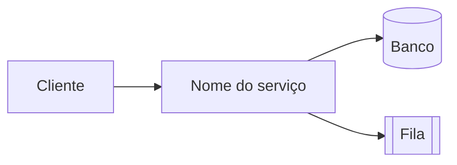

# [Nome do serviço]

> Uma frase que diz o que o serviço faz e para quem.

## Visão geral

- **Domínio:** [ex.: emissão de notas fiscais]
- **Tipo:** [API REST | worker | job agendado | front-end]
- **Linguagem/stack:** [ex.: Java 21 / Spring Boot 3]
- **Dependências:** [bancos, filas, serviços externos]
- **Repositórios relacionados:** [links]

## Arquitetura



## Como executar localmente

```bash
git clone <url>
cp .env.example .env   # preencha as variáveis abaixo
make run               # ou o comando equivalente
```

| Variável | Obrigatória | Descrição | Exemplo |
|---|---|---|---|
| `DATABASE_URL` | sim | string de conexão | `postgres://...` |

## Como testar

```bash
make test
```

## Implantação

- **Ambientes:** [dev / homolog / prod]
- **Pipeline:** [link]
- **Rollback:** [como reverter]

## Observabilidade

- **Logs:** [onde]
- **Métricas/dashboards:** [link]
- **Alertas:** [link]

## Decisões de arquitetura

- [ADR-0001 — Adotar Docs-as-Code](../adr/0001-adotar-docs-as-code.md)

## Runbook

Ver `docs/runbooks/<nome-do-servico>.md`.

## Contatos

- Time responsável: [canal]
- Plantão: [como acionar]
