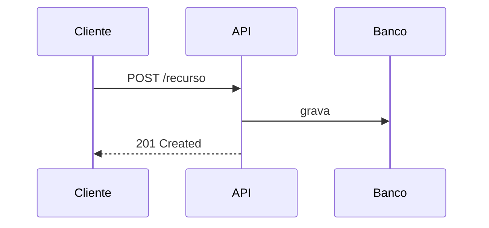

# API — [Nome]

> Prefira manter a especificação em OpenAPI (`openapi.yaml`) gerada a partir do código. Este documento complementa a especificação com o que não cabe nela: contexto, exemplos de fluxo e regras de negócio.

## Visão geral

- **Base URL:** `https://<host>/api/v1`
- **Autenticação:** [Bearer JWT | API key | OAuth2]
- **Versionamento:** [no path | no header]
- **Especificação:** `openapi.yaml` na raiz do serviço

## Fluxos principais

### [Nome do fluxo]



## Endpoints

### `POST /recurso`

Descrição:

#### Requisição

```json
{ "campo": "valor" }
```

#### Resposta `201`

```json
{ "id": "..." }
```

#### Erros

| Código | Quando |
|---|---|
| 400 | corpo inválido |
| 401 | não autenticado |
| 409 | conflito de regra de negócio: [qual] |

## Regras de negócio

-

## Changelog

| Versão | Data | Mudança |
|---|---|---|
| | | |
